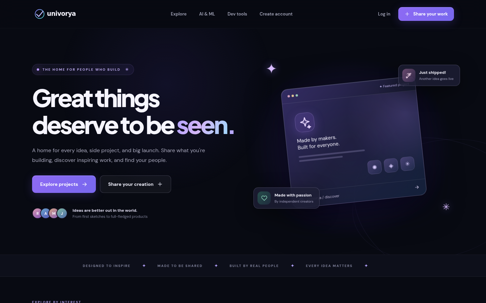
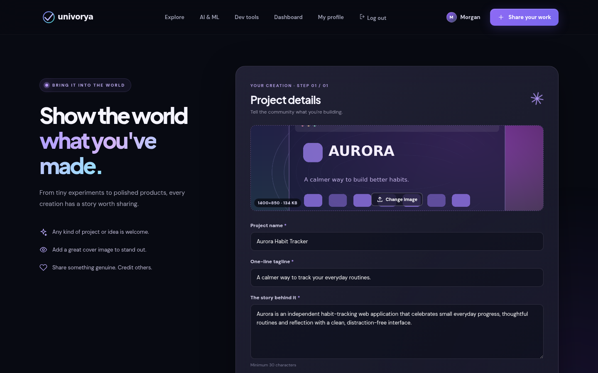
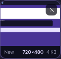
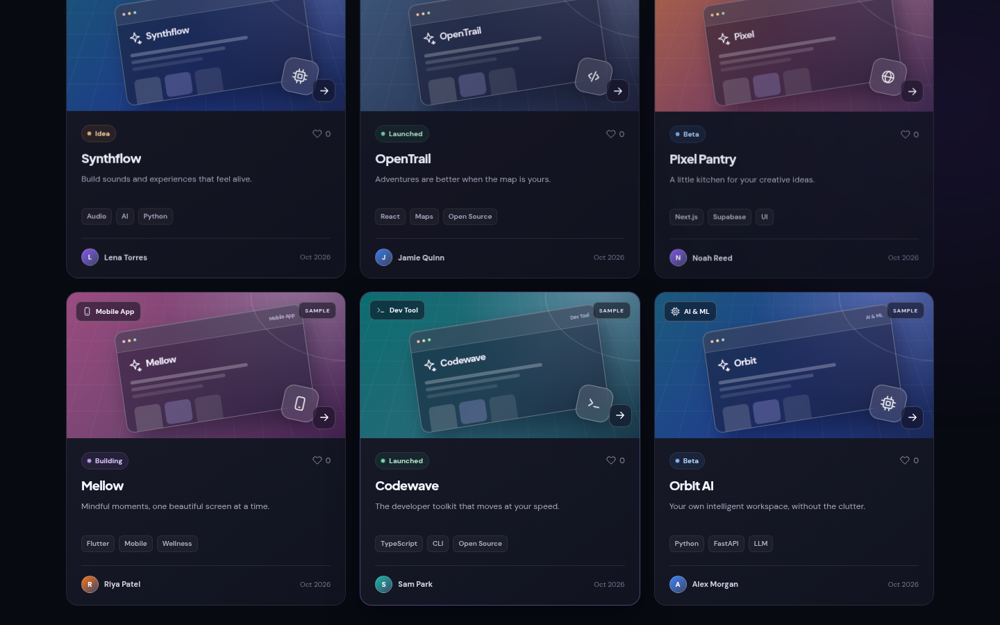
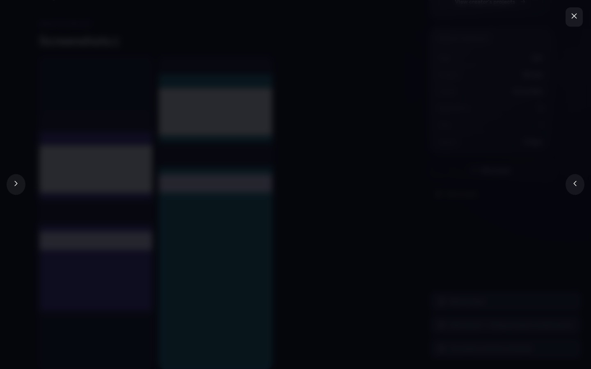
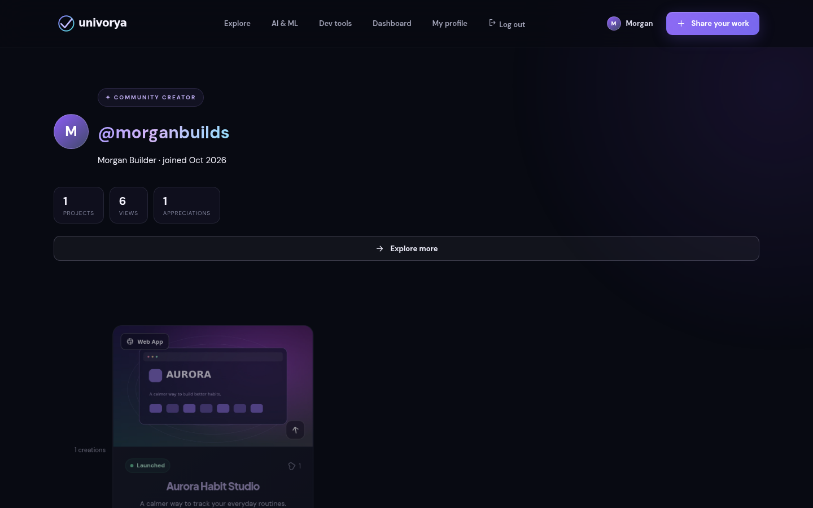
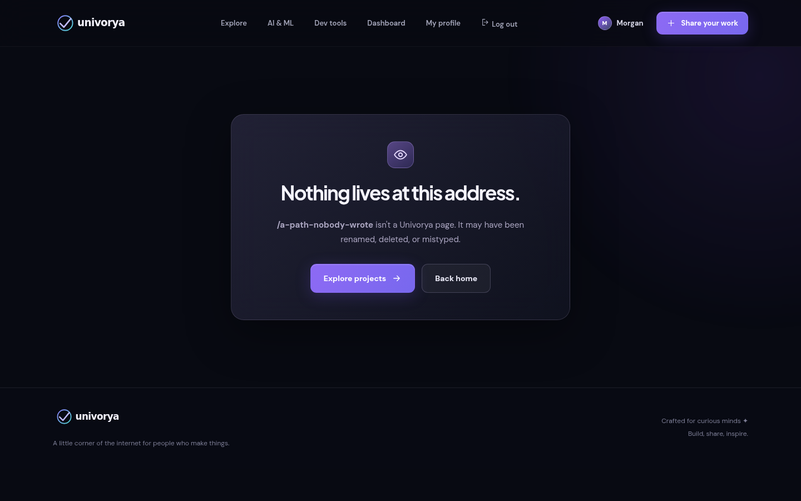
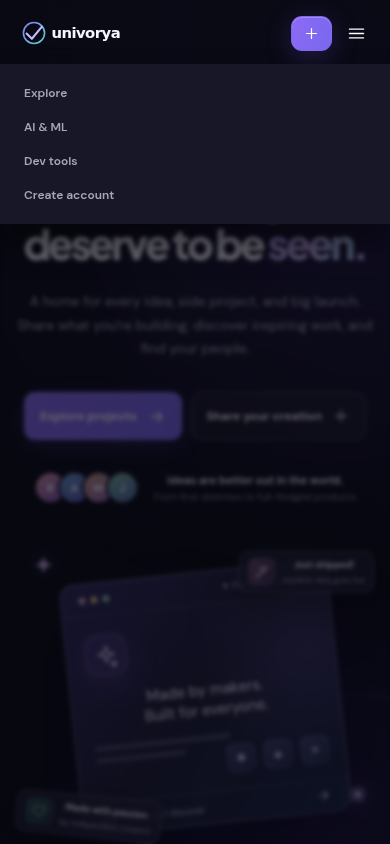
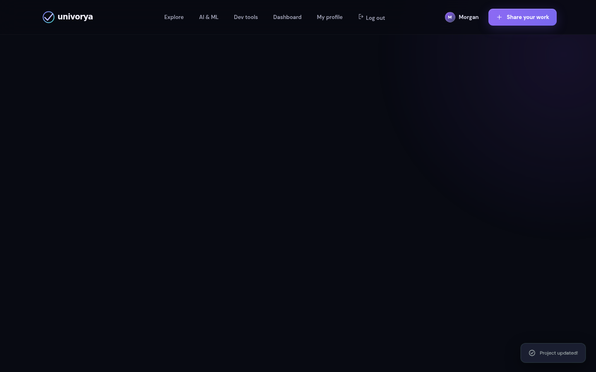

# Univorya

**Built by anyone. Discovered by everyone.**

A real, responsive showcase for apps, open-source projects, AI tools, designs, prototypes, experiments and
ideas — with accounts, uploads, discovery and an owner's own control over what they published. It is not a
clones-only website, and it does not host the things it points at.



**Scope:** Univorya stores project descriptions and images. It does not run uploaded code, host Git repos, serve
model weights or distribute APK/IPA binaries. The brand is **provisional** until domain and trademark clearance.

## What it looks like

| Publish | Your own uploads |
|---|---|
| The form every category goes through, with the cover preview showing the file's real size and weight. | A freshly picked screenshot tile, animating in with the pixel size and weight read from the file before it is uploaded. |
|  |  |

| Discovery | Lightbox | Portfolio | Honest 404 |
|---|---|---|---|
| Search, category and stage filters, sort and load-more. | Keyboard-navigable gallery with the file's own facts in the caption. | Creator page with project, view and appreciation counters. | Unknown routes and missing assets answer truthfully. |
|  |  |  |  |

| Mobile | After pruning the gallery |
|---|---|
| The same app at 390px, no horizontal scroll, drawer navigation. | Removing every screenshot leaves the cover standing — the case that used to fail silently. |
|  |  |

Every image above is produced by `python tests/browser_flow.py` against a throwaway instance, so the README
cannot drift from what the test actually sees.

## Use cases

Each flow is the path a person takes, what the server keeps, and the check that keeps it working.

### UC-01 · Publish an idea with nothing to deploy
- **Who:** student or newcomer with a concept — no repo, no live site.
- **Path:** `/join` → `/submit` → category *Idea*, stage *Idea*, optional cover → publish.
- **Stored:** one `projects` row plus one `project_media` row per image; the repo/demo/website columns stay empty strings, which is a valid submission.
- **On screen:** a stable `/p/<slug>` page credited to them, and the card animating into `/dashboard` and their maker profile.
- **Proven by:** the Chromium flow publishing an *Idea* entry through the real form, then reading the row back out of SQLite.

### UC-02 · Show an app with its screens
- **Who:** indie developer launching a product.
- **Path:** `/submit` → cover + up to 8 screenshots → stack, tags, stage, links → publish → `/edit/<slug>` later to drop shots or swap the cover.
- **Stored:** each file is decoded, stripped of camera/GPS metadata, shrunk (never upscaled), re-encoded to WebP, and recorded as a `project_media` row with width, height, byte size, animation flag and timestamp.
- **On screen:** the gallery tiles and lightbox caption render those stored facts; the creator's own edit form adds the upload date, so no returned field is fetched and discarded.
- **Proven by:** `test_each_stored_upload_reports_the_row_behind_it`, the metadata-stripping test, and the browser flow's tile assertions.

### UC-03 · Credit an open-source project properly
- **Who:** maintainer of a fork or an independently built project.
- **Path:** `/submit` → category *Open Source* → source repository URL + license field → contributors named in the description.
- **Stored:** the row keeps `repo_url` and `license`; links are scheme-checked and open with `rel="noopener noreferrer"`. Univorya never mirrors the repository itself.
- **On screen:** link buttons on the detail page, license in the project snapshot, attribution in the article body.
- **Proven by:** the URL-scheme and Origin checks in the API suite plus the category sweep that publishes an *Open Source* entry.

### UC-04 · Showcase an AI or design tool without shipping weights
- **Who:** AI engineer, designer or prototyper.
- **Path:** `/submit` → *AI & ML* / *Design* → demo or website link → screenshots, including an animated GIF/WebP preview.
- **Stored:** animations keep their frames and loop timing inside a hard budget — ≤5 MB per file, ≤40 frames, ≤40M decoded pixels per upload, ≤8 files and ≤25 MB combined.
- **On screen:** an `animated` badge on the tile, and the stored WebP served with immutable caching.
- **Proven by:** the animation-frame and pixel-budget tests, and the flow's `live`/`animated` flag checks.

### UC-05 · Browse, appreciate, and find the person behind the work
- **Who:** visitor, hiring manager, or another maker looking for prior art.
- **Path:** `/explore` → keyword search, category and stage filters, sort, load-more → open a project → like it → click through to `/makers/<username>`.
- **Stored:** one like per user per project, view counters, and the profile's project/upload/appreciation counts computed from the same rows.
- **On screen:** staggered card reveals, count-ups, and a profile that reports real numbers rather than decoration.
- **Proven by:** the discovery API tests and the flow's search, like and profile-counter steps.

### UC-06 · Stay in control of what you published
- **Who:** any signed-in creator.
- **Path:** `/dashboard` → edit (slug preserved) → drop or restore individual screenshots → delete the project.
- **Stored:** writes are owner-gated; deleting removes the project row, its `project_media` rows and every file it owned, leaving no orphan on disk.
- **On screen:** the edit form lists stored images with a remove/restore control per screenshot; signed-out visitors never see a form that cannot save.
- **Proven by:** the owner-only, orphan-file, `keep_media` presence and gallery-clearing tests, plus the signed-out gate step in the browser flow.

### UC-07 · Run or extend it locally
- **Who:** anyone reading the code.
- **Path:** `python scripts/preview.py` (starts the server and opens your browser), `docker compose up --build`,
  or Uvicorn with `UNIVORYA_DATA_DIR` pointing at a directory you own.
- **Stored:** SQLite (`users`, `sessions`, `projects`, `likes`, `project_media`) plus `uploads/`, all under that one directory.
- **On screen:** the app at `127.0.0.1`, with `/api/docs` and `/api/health`.
- **Proven by:** the HTTP smoke script run against a real server, and the test suite's throwaway instances.

### UC-08 · Open the thing you are showing, while it still only runs on your laptop
- **Who:** the creator of the project, on the machine where that project is running.
- **Path:** `/submit` → **Local preview address** → project page → **ON THIS MACHINE** panel → `Open on this
  machine`; or `python scripts/showcase.py <slug>` for a Chrome window with no tabs and no address bar.
- **Stored:** `projects.preview_url` — one column, `http(s)` on `127.0.0.1`, `localhost` or `::1` only, anything
  else refused with a 422 before the row is written.
- **On screen:** the address, the button and the terminal command appear in the aside **for the owner only**; a
  visitor's payload has no `preview_url` key at all, so there is nothing to render.
- **Proven by:** the 29 checks in `tests/test_local_preview.py`, and the browser flow, which fills the field
  through the real form, watches the button open a second window on that exact address, then loads the same page
  signed out and asserts the address is missing from both the DOM and the API response.

## Limitations we ran into — and closed

| The limitation | What it is now | Where the proof lives |
|---|---|---|
| One cover image per project, and a file on disk with no record of itself | Cover **plus** up to 8 screenshots, every file a `project_media` row with dimensions, weight, animation flag and timestamp | API media tests; browser category sweep |
| Uploads kept their EXIF: camera, software, capture time, GPS | Re-encode strips metadata and shrinks without upscaling | `test_a_re_encoded_image_loses_the_camera_and_location_metadata` |
| An animated upload could ask the server for far more pixels than a static one | Per-upload decode budget, frame cap and total byte cap; rejected uploads leave no file behind | animation budget tests |
| Client-side validation only, and an empty `keep_media` list was indistinguishable from an omitted one | Server validates on both verbs; field presence is read from the parsed form | `keep_media` tests |
| No limit on repeated password guesses | Sliding-window throttle: 10 per account, 30 per client, 15 signups per client per 10 minutes (in-process) | throttling tests |
| A canonicalisation redirect that could hand a visitor `//attacker.example` | Redirect targets are built same-origin, and the test forbids any `Location` starting with `//` or a scheme | `test_a_double_slash_cannot_make_the_canonical_redirect_leave_our_origin` |
| Google Fonts `@import` and inline `onclick` handlers, both silently blocked by our own CSP | Self-hosted variable font subsets; one delegated `data-action` handler | hardening source guards |
| Unknown routes answered with the explore grid; a typo'd asset URL returned the HTML shell | Real not-found view; extension-bearing paths 404 | not-found and missing-asset tests |
| A malformed `%zz` in a URL threw and left a blank page | Defensive decode with a raw-segment fallback | malformed-path step in the browser flow |
| Scroll-reveal CSS could leave content permanently invisible if a re-render skipped the observer | Observer is re-armed after every render; `prefers-reduced-motion` shows everything at full opacity with zero running animations | the flow fails if any `.reveal` stays at opacity 0 |
| HTML cached as if it were static, API responses cacheable | Policy by volatility: `no-store` for `/api`, `immutable` for content-addressed media and fonts, `no-cache` elsewhere | `test_cache_policy_matches_how_often_a_url_can_change` |
| Sample content could be mistaken for real users | Fictional demo cards are labelled in the UI and switch off with `UNIVORYA_SEED_DEMO=0` | demo-labelling tests |
| A project that only runs on its author's laptop had nowhere to point: every link field assumed it was deployed | A loopback-only `preview_url`, validated on both verbs, hidden from every non-owner payload, and opened by an owner-only button or `scripts/showcase.py` | `tests/test_local_preview.py`, the popup and signed-out steps in the browser flow |

## Limitations we have not closed

Honest list, not a to-do we pretend is done:

- No live deployment: no public URL, production TLS, managed storage or Postgres, and no CDN in front of the
  uploads.
- No email verification, password reset, captcha, abuse reporting, moderation or takedown workflow — do not open
  signup to strangers before those exist.
- The throttle map is in-memory and per process: multiple workers each hold their own counters, a restart clears
  them, and behind a reverse proxy every visitor can collapse into one bucket unless `--forwarded-allow-ips` and
  `X-Forwarded-For` rewriting are configured. See [docs/TEST_REPORT.md](docs/TEST_REPORT.md).
- Single Chromium engine, one viewport pair, no full WCAG audit, load test or penetration test.
- Local preview is the creator's own machine only. A page served over HTTP cannot start a program on the visitor's
  computer, so `Open on this machine` opens a window in the browser the creator is already using, and the tab-less
  Chrome window needs the local `scripts/showcase.py`. Visitors get the public links, never the loopback address.
- The vendored OFL font subsets still need an attribution file, and there are no privacy/terms pages yet.
- Phase 2 items — GitHub identity verification, teams, unlisted drafts, analytics, notifications — are
  unimplemented. See [docs/REQUIREMENTS.md](docs/REQUIREMENTS.md).

## Features

- Dark glassmorphism UI with responsive desktop/mobile layouts and a custom SVG wordmark.
- Local creator accounts: register, login, logout, scrypt-hashed passwords, HttpOnly session cookies.
- Publish **projects and ideas** with title, description, tags, 8 categories, 4 lifecycle stages, technologies,
  license and optional demo/GitHub/website links.
- Public project detail pages, creator portfolios, discovery filters/search, sort and load-more pagination.
- Motion layer of 20 keyframe animations — scroll reveals, staggered cards, count-ups, toasts, drawer and
  lightbox transitions — with a full `prefers-reduced-motion` fallback.
- Logged-in likes, owner-controlled edit/update and delete, saved image replacement.
- Owner-only **local preview**: store the loopback address your project runs on and open it straight from your own
  showcase page, or in a tab-less Chrome window with `scripts/showcase.py`.
- 87 API tests and a Chromium interaction smoke that boots a real server, both green on GitHub Actions for every
  push to `main`, plus a real-network smoke script, Docker, and reference screenshots generated by the tests
  themselves.

## Start with Docker

```bash
docker compose up --build
```

Open http://localhost:8000. SQLite and uploads persist in the named volume `univorya-data`.

## Start with Python (3.11+)

```bash
python -m venv .venv
source .venv/bin/activate  # Windows: .venv\\Scripts\\activate
pip install -r requirements.txt
uvicorn app.main:app --host 127.0.0.1 --port 8000 --reload
```

Open http://127.0.0.1:8000. Swagger API docs at `/api/docs` and health endpoint `/api/health`.

Set `UNIVORYA_DATA_DIR=./data` to choose where SQLite and uploaded images are stored. Use a durable disk/volume for persistence.

## See it in a real browser window

```bash
python scripts/preview.py            # starts the server if needed, then opens your browser
python scripts/preview.py --temp     # same, on a throwaway database — nothing touches data/
python scripts/preview.py --no-browser
```

The launcher polls `/api/health` before it opens anything, so the browser never lands on a half-booted server,
and if something is already serving the port it reuses that instance instead of failing to bind. It defaults to
`127.0.0.1:8123` with the `data/` directory; `--data-dir`, `--host` and `--port` move it.

To drive the window yourself instead — the way an agent or a reviewer would — open a dedicated app window, or
point an IDE's in-app browser at the same URL:

```bash
google-chrome --app=http://127.0.0.1:8123/ --user-data-dir=/tmp/univorya-view
```

The same trick is what **local preview** does for a creator's own project. Put `http://localhost:5173` (or any
`127.0.0.1` / `::1` address) in the **Local preview address** field on `/submit`, then from your project page:

```bash
python scripts/showcase.py <slug>            # opens it in a Chrome app window of its own
python scripts/showcase.py <slug> --print    # only print the stored address
```

The script reads the address out of SQLite in read-only mode, refuses anything that is not loopback, refuses to
open a window when nothing is listening on that port, and keeps its own profile directory so it never touches your
everyday Chrome. `--data-dir` and `--browser` move those choices.

The window is the full product: publish through `/submit` in any of the eight categories, then watch
`/dashboard`, your maker profile and the project page animate in. Every image you upload becomes a
`project_media` row, and its stored facts (kind, pixel size, weight, animation, upload date) are rendered from
that row on the gallery tile, in the lightbox caption and on your own edit form. `UNIVORYA_HEADED=1 python
tests/browser_flow.py` drives the same window end to end if you would rather watch the checks run.

## Run tests

```bash
pip install -r requirements-dev.txt
pytest --cov=app --cov-fail-under=85 -q   # 87 API tests, 94% of app/main.py
node --check static/app.js                # JavaScript syntax
python tests/browser_flow.py              # Chromium UI smoke; regenerates the screenshots above
UNIVORYA_HEADED=1 python tests/browser_flow.py   # same run in a visible browser window
```

To run the real HTTP smoke separately, start Uvicorn then:

```bash
UNIVORYA_TEST_URL=http://127.0.0.1:8000 python scripts/smoke_http.py
```

The browser test boots a real Uvicorn server on a free port with a **temporary** data directory, so no test run
writes to `data/`. It publishes one project per category through the form and reads the rows back out of SQLite,
then fails if any reveal element never reaches full opacity. Coverage is a correctness signal, not a security
certification.

## Source layout

```text
app/main.py                    FastAPI backend: session auth, uploads, persistence, REST
static/                        index.html, app.js, styles.css, logo, self-hosted fonts
scripts/smoke_http.py          Real-network regression check
scripts/preview.py             Start locally and open a real browser once /api/health answers
scripts/showcase.py            Open a creator's own loopback preview in a Chrome app window
tests/                         87 API checks + Chromium interaction smoke
.github/workflows/ci.yml       API + JS + Chromium pipeline
docs/                          Requirements, architecture, test report, screenshots
Dockerfile / docker-compose.yml
```

## Documentation

- [docs/REQUIREMENTS.md](docs/REQUIREMENTS.md) — personas, acceptance criteria, non-goals, release gate.
- [docs/ARCHITECTURE.md](docs/ARCHITECTURE.md) — data model, request flow, security notes and caveats.
- [docs/TEST_REPORT.md](docs/TEST_REPORT.md) — what was run, what was observed, and what is explicitly not claimed.
