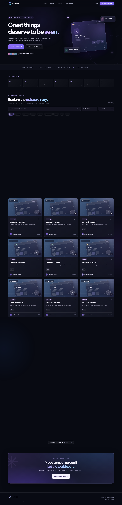

# Univorya

**Built by anyone. Discovered by everyone.**

A real, responsive developer and maker showcase for apps, open-source projects, AI tools, prototypes, experiments and ideas. It is not a clones-only website.



## Features

- Dark glassmorphism UI with responsive desktop/mobile layouts and custom SVG wordmark.
- Local creator accounts: register, login, logout, password hashing, HttpOnly session cookies.
- Publish **projects and ideas** with title, description, tags, categories, lifecycle stage, technologies and optional demo/GitHub/website links.
- Upload cover images (PNG, JPEG, GIF or WebP, max 5MB); backend re-encodes to WebP.
- Every upload is stored as a queryable `project_media` row (cover **and** up to 8 screenshots per project, in any category), with real dimensions, byte size and animation flags returned by the API.
- Public project detail pages, creator portfolios, discovery filters/search, sort and load-more pagination.
- Detail pages show an animated screenshot gallery with a keyboard-navigable lightbox, and the maker page reports upload/like/view counts from the database.
- Motion layer of 20 keyframe animations — scroll reveals, staggered cards, count-ups, toasts, drawer and lightbox transitions — with a full `prefers-reduced-motion` fallback.
- Self-hosted variable fonts, so no request leaves the origin under the app's CSP.
- Logged-in likes, owner-controlled edit/update and delete, saved image replacement.
- Demonstration gallery with **explicitly labeled fictional examples**, optional via `UNIVORYA_SEED_DEMO=0`.
- Automated API tests, Chromium UI smoke, CI workflow, Docker and real-network smoke script.

**Scope:** This publishes project descriptions and images only. It does not host apps, Git repos, model weights, executables or application binaries. Univorya is a **provisional brand** until domain/trademark clearance.

## Start with Docker

```bash
docker compose up --build
```

Open http://localhost:8000. SQLite and uploads persist in the named volume `univorya-data`.

## Start with Python (3.11+)

```bash
python -m venv .venv
source .venv/bin/activate  # Windows: .venv\\Scripts\\activate
pip install -r requirements.txt
uvicorn app.main:app --host 127.0.0.1 --port 8000 --reload
```

Open http://127.0.0.1:8000. Swagger API docs at `/api/docs` and health endpoint `/api/health`.

Set `UNIVORYA_DATA_DIR=./data` to choose where SQLite and uploaded images are stored. Use a durable disk/volume for persistence.

## Run tests

```bash
pip install -r requirements-dev.txt
pytest --cov=app --cov-fail-under=85 -q   # 52 API tests, 94% coverage
node --check static/app.js       # JavaScript syntax
python tests/browser_flow.py     # Chromium UI smoke; generates screenshots
UNIVORYA_HEADED=1 python tests/browser_flow.py   # same run in a visible browser window
```

To run the real HTTP smoke separately, start Uvicorn then:

```bash
UNIVORYA_TEST_URL=http://127.0.0.1:8000 python scripts/smoke_http.py
```

Tests cover signup, cover + multi-screenshot upload with a `project_media` row per file, animated GIF handling, optimized WebP delivery, publish, update, media pruning (including clearing the whole gallery), discovery, likes, maker profiles, owner-only deletion, brute-force throttling, cache policy, and honest 404s for missing assets and unknown routes. The browser test boots a real Uvicorn server on a free port and drives it with Chromium, so `UNIVORYA_HEADED=1` shows the same clicks in a window you can watch. GitHub CI will run the same suites after repository push.

## Source layout

```text
app/main.py                    Python FastAPI, session auth, persistence, REST endpoints
static/                        HTML, CSS, JS, logo
scripts/smoke_http.py          Real network regression check
.github/workflows/ci.yml       API + JS + Chromium pipeline
tests/                         52 API checks, browser interaction smoke
docs/REQUIREMENTS.md           Product requirements and acceptance criteria
docs/ARCHITECTURE.md           Architecture/data model/risk notes
docs/TEST_REPORT.md            Observed tests and caveats
Dockerfile / docker-compose.yml
```

## Push to GitHub

Until an empty GitHub repository named `univorya` exists, the connected GitHub tool cannot create or push to a new repo. Once created in the `humaniods` account, use the prepared local Git repository:

```bash
git remote add origin https://github.com/humaniods/univorya.git
git push -u origin main
```

**Do not force push to any existing unrelated repository.** `.gitignore` excludes local DB, uploads and secrets.

**Local coverage:** 89% statement coverage across the FastAPI backend in the recorded test run. Coverage is not a security certification.

## Not yet production-ready

Before onboarding unknown public users: verified email, password reset, abuse moderation, IP takedown process, reliable cloud image storage and database, centralized rate limits, backups, monitoring, privacy/terms, and full accessibility/security review. See [Requirements](docs/REQUIREMENTS.md), [Architecture](docs/ARCHITECTURE.md) and [Test Report](docs/TEST_REPORT.md).
