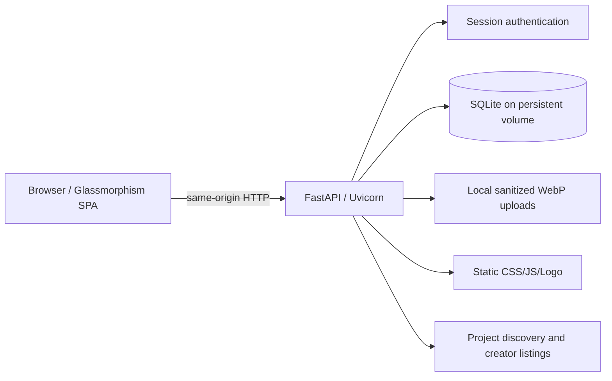

# Architecture — Univorya v0.2

## Structure

- `static/index.html`, `static/styles.css`, `static/app.js`, `static/logo.svg`: responsive client, routes, image previews, filters, project edit/publish actions.
- `app/main.py`: single origin backend, sessions, SQLite schema/queries, image processing, CRUD, health and static routing.
- `tests/test_api.py` + `tests/test_extended.py`: isolated TestClient functional and safety regression checks.
- `tests/browser_flow.py`: Chromium UI smoke against real FastAPI TestClient via browser adapter for this sandbox.
- `scripts/smoke_http.py`: **real network** smoke for an authorized running deployment.
- `.github/workflows/ci.yml`: Python tests + JS syntax + browser smoke in GitHub Actions.

## Data model

- `users`: unique email and username; name, scrypt password digest, created time.
- `sessions`: hashed random token, user foreign key, expiry; cookie is HttpOnly.
- `projects`: owner, stable slug, metadata, tags, optional links, stage, image, dates, views, demo flag.
- `likes`: unique user/project pair preventing duplicate likes.

## Runtime boundaries

- Public-facing project gallery and creator pages are generated by client JS using escaped API fields.
- Uploaded binaries are **not executed**; only raster images are accepted and re-encoded.
- The app serves all features from one origin; no separate frontend API environment variables needed for local use.
- Multiple application replicas sharing SQLite/local uploads are **not a supported production architecture**. Use single-instance persistent volume only for a small pilot.
- Demo seeding is for previews. Disable with `UNIVORYA_SEED_DEMO=0` when onboarding real users.

## Known risks and mitigations before public launch

- No verified emails; abusive signups are still possible. In-process caps exist (10 failed logins per account, 30 per client, 15 signups per client, each inside a 10-minute window), but they live in one Python process: add email verification, bot checks and shared/edge rate limiting before a public launch. The per-client caps key on the socket peer address, and Uvicorn is started with `--proxy-headers`, whose trusted-Proxy list defaults to `127.0.0.1` — behind a same-host reverse proxy that header must be *overwritten* by the proxy (and `--forwarded-allow-ips` set) or the client buckets are spoofable; see the deployment note in [TEST_REPORT.md](TEST_REPORT.md).
- Mismatched Origin blocked where sent; full CSRF assessment and dedicated token strategy recommended for public production.
- SQLite is simple but not a managed/high-availability database; migrate to Postgres and object storage as usage grows.
- Missing report/takedown workflow; required before unmoderated public publishing.
- No automated scans of external demo/repo links: treat them as external untrusted URLs.
- Browser test uses sandbox adapter; use real deployment plus `scripts/smoke_http.py` and Playwright navigation before launch.
