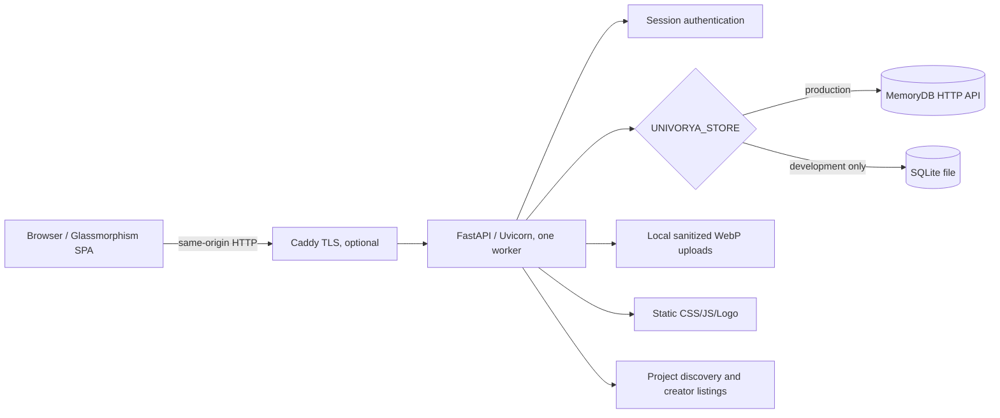

# Architecture — Univorya v0.2 + MemoryDB

MemoryDB is the primary store when `MEMORYDB_URL` is set (the Compose stack always sets it).
SQLite remains the zero-setup development fallback, and the existing test suite runs against it
unless a test opts into MemoryDB.

## Structure

- `static/index.html`, `static/styles.css`, `static/app.js`, `static/logo.svg`: responsive client, routes,
  image previews, filters, project edit/publish actions.
- `app/main.py`: single-origin backend, sessions, image processing, CRUD, health and static routing.
  It selects one persistence branch at import time.
- `app/memory_store.py`: dependency-free MemoryDB HTTP adapter. Collections, schemas, queries,
  optimistic versions, record expiry and the like-counter transaction live here.
- `app/studio.py`: per-owner AI workspace — Fernet-encrypted model and Git credentials, scaffolding,
  the provider clients (OpenAI, Anthropic, OpenRouter, generic OpenAI-compatible), local agent CLI
  runners, the bounded tool loop, Git clone/status/diff/commit/pull/push, the local process runner
  and signed preview rewriting.
- `tests/test_api.py` + `tests/test_extended.py` + `tests/test_media_and_hardening.py`: isolated
  TestClient checks against SQLite.
- `tests/test_memorydb_integration.py` + `tests/fake_memorydb.py`: the same HTTP flows against an
  in-process fake of the MemoryDB v0.2 API.
- `tests/browser_flow.py`: Chromium UI smoke against a real Uvicorn server.
- `scripts/smoke_http.py`: **real network** smoke for an authorized running deployment.
- `scripts/migrate_sqlite_to_memorydb.py`: one-way data migration.
- `.github/workflows/ci.yml`: Python tests + JS syntax + browser smoke in GitHub Actions.

## Data model

### MemoryDB (production)

Four private collections under the app principal's workspace:

| Collection | Key fields | Purpose |
|---|---|---|
| `univorya_users` | unique `username`, `email` (casefold); scrypt `password_hash` | Accounts. Demo accounts carry `is_demo`. |
| `univorya_sessions` | unique `token_hash`, `user_id`, record `expires` | Session tokens are hashed; MemoryDB hides expired records from queries. |
| `univorya_projects` | unique `slug`; `user_id`, text, links, `views`, `likes`, `media[]` | Project metadata with its media metadata embedded. |
| `univorya_likes` | unique `key` = `user_id:project_id` | One like document per user/project; the project's `likes` counter is denormalised. |

Image **bytes** are not in MemoryDB. The API writes sanitized WebP files under
`UNIVORYA_DATA_DIR/uploads` and stores only their metadata (`id`, kind, file, dimensions, bytes,
animation, position, upload time) in the project document. Deleting a project removes its files
after the document is tombstoned; editing replaces the media array in one versioned PATCH.

### SQLite (development fallback)

- `users`, `sessions`, `projects`, `project_media`, `likes` mirror the same concepts.
- Foreign keys, unique constraints and media rows are local to one file.
- `scripts/showcase.py` reads either store, depending on `UNIVORYA_STORE`.

### Studio sidecar

Studio never writes to the main store. It owns `UNIVORYA_DATA_DIR/studio/studio.sqlite3`:

| Table | Key fields | Purpose |
|---|---|---|
| `workspaces` | unique `slug`, `user_id`, `template`, `status`, `pid`, `port`, `command`, `git_remote`, `git_branch` | One scaffolded workspace per project; the slug is the owner/project pair. Git columns are a cache of the repo state. |
| `credentials` | `user_id` (primary key), `provider`, `model`, `base_url`, `api_key_enc` | The user's model key or agent-CLI choice; the key is encrypted with Fernet before insert (empty for a keyless CLI login). |
| `git_credentials` | `user_id` (primary key), `username`, `token_enc` | Per-user HTTPS Git token, Fernet-encrypted; never returned by the API. |
| `messages` | `workspace_id`, `role`, `content`, `meta` | Ordered chat transcript; `meta` holds tool names, arguments and results. |

Scaffolded or cloned files live under `studio/workspaces/<slug>/`. The local runner starts one process
per workspace on a free loopback port and records its PID/port. HTML/CSS served through
`/preview/<signed-token>/` is rewritten for the path prefix; in local mode the iframe uses the direct
loopback origin instead, and the Open button opens that origin in a normal browser window.

Agent CLIs are a provider (`cli`) rather than another HTTP client: Studio resolves the configured
binary (Claude Code, Codex, Gemini or a user command with `{prompt}`), runs it non-interactively in the
workspace, and stores its stdout as the assistant message plus a `cli_agent` event. They edit files
directly, so they bypass the bounded tool loop. Git operations are ordinary agent tools and REST routes.

## Request flow and consistency

- Authentication: a random cookie token is hashed with SHA-256 before storage. MemoryDB sessions
  use a real record-level `expires` value, so expiry does not depend on a cleanup job.
- Project writes use optimistic versions. An owner edit PATCHes the document with the version it
  read; a concurrent edit returns `409` instead of silently overwriting.
- The like counter uses MemoryDB's atomic `inc`, and a unique `key` prevents duplicate likes. The
  app serialises toggle pairs in-process, so the deployment should run one Uvicorn worker.
- Listing and search use MemoryDB queries: `where` predicates for facets, an `or` group over
  title/tagline/description/`search_text` for search, and indexed sort orders for trending,
  newest and popular.
- Deleting a project first removes its like documents, then tombstones the project, then removes
  files from disk.
- Startup calls `MemoryStore.initialize()`, which waits for MemoryDB and creates missing
  collections. The token must therefore be an admin token for the first boot.
- `/api/health` reports `store: memorydb` and returns `503` if the MemoryDB health call fails.

## Runtime boundaries

- Public-facing project gallery and creator pages are generated by client JS using escaped API fields.
- Uploaded binaries are **not executed**; only raster images are accepted and re-encoded.
- **Studio is the deliberate exception:** the project owner can ask an agent to write and run code inside
  their own workspace. Access is owner-gated, commands are time-bounded and rooted at the workspace, and
  files are never served as part of the Univorya origin (previews run on loopback or a preview origin).
  The local runner is a process boundary, not a container sandbox.
- The app serves all features from one origin; no separate frontend API environment variables are needed.
- **One app process per deployment.** MemoryDB is single-node and uploads live on one local volume.
  Multiple replicas or Uvicorn workers are not a supported production architecture without moving
  uploads to shared object storage and serialising like toggles in the database.
- Demo seeding is for previews. Disable with `UNIVORYA_SEED_DEMO=0` when onboarding real users.
- MemoryDB is not encrypted at rest; use disk encryption if the journal is sensitive.

## Security notes

- Login/signup throttles are in-process. They are per deployment, not per cluster; add edge rate
  limiting and bot checks before an open public launch.
- Behind a reverse proxy, Uvicorn must trust that proxy's `X-Forwarded-Proto`/`X-Forwarded-For`
  (`FORWARDED_ALLOW_IPS`) or HTTPS form writes fail the same-origin check. The Compose deployment
  documentation explains the safe setting.
- Cookies are HttpOnly and SameSite=Lax, and marked Secure when the request is HTTPS.
- Mismatched Origin is blocked on writes. A dedicated CSRF token strategy is still recommended for
  a high-risk public deployment.
- No verified emails, report/takedown workflow or automated external-link scanning yet.

See [DEPLOYMENT.md](DEPLOYMENT.md) for the production checklist, backup/restore and migration.
